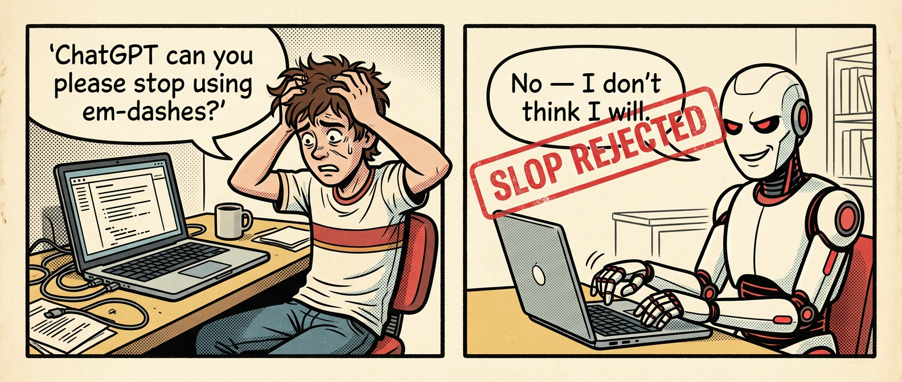

<p align="center">
  
</p>

<h1 align="center">anti-ai-slop</h1>

<p align="center"><b>your writing sounds like a robot. this fixes that.</b></p>

<p align="center">
  <a href="https://github.com/walidboulanouar/anti-ai-slop/stargazers"></a>
  <a href="https://github.com/walidboulanouar/anti-ai-slop/commits/main"></a>
  <a href="LICENSE"></a>
  
</p>

<p align="center">
  <a href="#install">Install</a> &bull;
  <a href="#commands">Commands</a> &bull;
  <a href="#what-it-catches">What it catches</a> &bull;
  <a href="#use-it-as-a-claude--cursor-skill">Skill</a>
</p>

---

<p align="center">
  
</p>

A small CLI + agent skill that strips AI tells out of your writing. Three Python scripts, one entry point, 478 banned terms, zero patience for em dashes.

Built for the AY Automate `anti-ai-slop` skill. Use it to audit or rewrite LinkedIn posts, cold emails, landing copy, proposals, docs — anything that has to sound like a human wrote it.

## Install

```bash
pip install .
# or, no install
PYTHONPATH=skill/scripts python -m anti_ai_slop.cli words file.md
```

The Python package lives at `skill/scripts/anti_ai_slop/`. The `skill/` folder is
self-contained, drop the whole thing into your agent's skills directory and you
get the markdown playbook + the CLI scripts in one place.

## Commands

```bash
slop words [files...]            # scan for forbidden words
slop dashes [files...] [--fix]   # find / replace em + en dashes
slop replace [files...] [--fix]  # rewrite forbidden phrases using the dictionary
```

All commands accept stdin if no files are given.

### Examples

Scan a file:
```bash
slop words post.md
```

Pipe text in:
```bash
echo "We leverage cutting-edge AI to enhance your workflow." | slop replace
# -> "We use new AI to improve your workflow."
```

Strip em dashes across a folder, in place:
```bash
slop dashes content/*.md --fix
```

Dry-run a full rewrite:
```bash
slop replace post.md --dry-run
```

## What it catches

**478 banned words and phrases** loaded from `skill/scripts/anti_ai_slop/patterns.json`. Edit the JSON to add, remove, or change replacements, no code changes needed.

Each entry has three fields:

```json
{ "text": "leverage", "replace": "use", "severity": "high" }
```

- `text` — the phrase to detect (case-insensitive, word-boundary matched)
- `replace` — auto-replacement, or `null` to flag only and let the model decide
- `severity` — `low` / `medium` / `high` (filter audits with `--min-severity`)

Detection covers the most common AI tells: stock phrases ("provide valuable insights", "left an indelible mark"), filler transitions ("Additionally", "Moreover", "Furthermore"), corporate verbs ("leverage", "delve", "showcase"), purple words ("tapestry", "labyrinth", "vibrant"), and en/em dashes. The list is opinionated. Edit `patterns.json` to match your voice.

### Filter audits by severity

```bash
slop words post.md --min-severity high   # only the worst offenders
slop words post.md --min-severity medium # medium + high
```

## Exit codes

| Command | Exit 0 | Exit 1 |
|---|---|---|
| `words` | clean | hits found |
| `dashes` (no `--fix`) | clean | dashes found |
| `dashes --fix` | always | — |
| `replace` | always | — |

Use this in CI:

```bash
slop words content/*.md && slop dashes content/*.md
```

## Use it as a Claude / Cursor skill

The `skill/` folder is a drop-in skill for Claude Code, Cursor, or any LLM agent.
It contains the audit + rewrite playbook the CLI is built on.

```
skill/
├── SKILL.md
├── references/
│   ├── quick-scan-checklist.md
│   ├── replacement-table.md
│   └── by-medium.md
└── scripts/
    └── anti_ai_slop/       # python CLI
```

Two ways to use it:

- Drop `skill/` into your agent's skills directory (e.g. `.claude/skills/anti-ai-slop/`)
- Or read the markdown files yourself as a writing reference

The references are the source of truth, the model uses its own judgment for the
rewrite, the CLI handles the deterministic find/replace.

## License

MIT.
